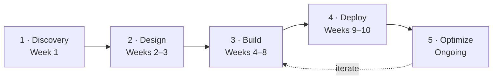

<div align="center">


# J. SERVO

### Your AI Partner In Business

**AI agents, automation and ERP for startups & SMEs: Cairo & the GCC**

[](https://jservo.com)
[](https://linkedin.com/company/jservo)
[](https://www.trustpilot.com/review/jservo.com)
[](https://wa.me/201011165461)
[](mailto:yousef@jservo.com)


[About](#about) · [Open Source](#open-source) · [Services](#services) · [Case Studies](#case-studies) · [Free AI Tools](#free-ai-tools) · [How We Work](#how-we-work-the-ai-transformation-blueprint) · [Contact](#get-in-touch)

</div>

---

## About

**J. SERVO LLC** helps startups and SMEs **achieve more with less**. We cut the noise, streamline
operations and put businesses on autopilot with customised ERP systems, AI integrations,
autonomous workflows and agentic AI development.

Many companies in our region still run on legacy systems and manual work cycles, or are still
deciding whether to go online at all. We step in as a **strategic AI partner** and make complex tech
simple, practical and scalable. Technology adapts to the business, not the other way around.

> **AI solutions are not one size fits all.** Every engagement starts with an assessment, and only
> moves to automation once the business is *AI ready*.

Founded by **[Yousef Ali](https://jservo.com/founder-yousef-ali/)**.

---

## Open Source

| Repository | Stack | What it is |
| --- | --- | --- |
| **[diwan](https://github.com/j-servo/diwan)** | TypeScript · three.js · React Three Fiber · Node 20+ | **Houses of knowledge for your AI agents.** Every Claude Code session on your machine becomes a scholar in a living 3D diorama of history's great houses of learning. |
| **[j-servo](https://github.com/j-servo/j-servo)** | Markdown | This profile. |

### Diwan

<p align="center">
  
  
</p>

In the Abbasid state the *dīwān* was the bureau where the empire's work got done. Diwan is that
office for your AI agents.

- **Live mode:** watches every Claude Code session and shows each one as a scholar reading,
  writing, running commands or searching, handing work to apprentices, and lighting a lamp when it
  needs your approval.
- **Steer mode** (`diwan --steer`): launches sessions through the Claude Agent SDK with an exact
  model, effort level and token budget. You approve or deny tool calls from the hall, and every
  action goes to an audit log.
- **Two worlds:** the **House of Wisdom** (بيت الحكمة, 9th-century Baghdad) and the **House of
  Life** (pr-ꜥnḫ, a Ptolemaic temple in the Dendera manner).
- **Secure by default:** loopback-only server, Host/Origin checks, read-only watch mode, per-run
  tokens for steer mode and secrets redacted before they leave the server.

```bash
git clone https://github.com/j-servo/diwan && cd diwan
npm install
npm run build:diwan
npm run diwan          # serves the hall on http://127.0.0.1:3200/
```

Diwan is a fork of the MIT-licensed [Pixel Agents](https://github.com/pixel-agents-hq/pixel-agents) by Pablo De Lucca.
The inherited code stays MIT; J. SERVO's additions are proprietary. See the repo's `LICENSE` and `NOTICE.md`.

---

## Services

| | Service | What you get |
| --- | --- | --- |
| 🤖 | **AI-Powered Business Solutions** | Agentic AI development and Web2Agent services, customer-service chatbots, autonomous workflows, AI modules for ERP/CRM, and business strategy with ROI projections |
| 🔄 | **Digital Transformation** | A move from legacy operations to agile, tech-driven ecosystems that aligns people, processes, resources and technology |
| 🏢 | **ERP Systems** | Finance, HR, projects, sales, CRM, POS, document management and QA/QC in one customised platform |
| 📊 | **Project Controls & Management** | PMS-powered planning, tracking, cost, schedule, risk and quality, with automated reporting |
| 🛡️ | **AI-Enabled Compliance & Governance** | Company policies (HSE, QA/QC, SOPs), operational templates and DMS: the "operating manual" you need before AI |
| ⚡ | **AI Automation** | Data entry, compliance checks, customer-service layers and financial forecasting turned into autonomous systems |
| 🧭 | **Strategic Planning & Process Optimisation** | Workflow analysis, QMS and DMS implementation, faster execution and lower costs |
| 💬 | **[WhatsApp Chatbot](https://jservo.com/whatsapp-chatbot/)** | Multi-agent omnichannel support and lead capture |

**Core tech we build with:** Next.js · React · React Flow · Three.js · Node.js · FastAPI · Python ·
PyTorch · n8n · Mastra · Qdrant · Ollama · DeepSeek R1 · Gemini · OpenRouter · Twilio · WhatsApp API · WordPress.

→ Full details: **[jservo.com/ai-solutions](https://jservo.com/ai-solutions/)**

---

## Case Studies

These are production systems from **[jservo.com/case-studies](https://jservo.com/case-studies/)**. Results are as reported by J. SERVO.

| Project | Domain | Stack | Result |
| --- | --- | --- | --- |
| **POJEHAT** | Omnichannel AI | Mastra · WhatsApp API · n8n · Qdrant | 24/7 replies in under 1.2 s; over 70% of tier-1 support queries automated |
| **DELTA** | ERP & 3D web graphics | Next.js · FastAPI · Three.js | Drafting cycles 65% shorter, inventory discrepancies under 0.5%, automated BOMs |
| **BRICS** | Zero-retention RAG | DeepSeek R1 · Ollama · Qdrant · on-prem, air-gapped | 100% data sovereignty; cross-border legal reviews 4.5x faster |
| **QuranMath** | Classical Arabic NLP | PyTorch · FastAPI · semantic graphs | 98.9% semantic alignment across 50,000+ student sessions |
| **QWIRVA** | B2B sales engine (with **Aghrba**) | Twilio Voice · LLM lead grading | 250,000+ leads scored, 80% of spam removed, 3.2x more qualified appointments |
| **SUNDIAL** | Autonomous systems | Python daemon · Autonomy Gate · HID presence | 99.99% uninterrupted overnight multi-agent runs over 1,000+ hours |
| **Dragonfly** | Agentic AI architecture | React Flow · Gemini · Express · Vercel | Sales cycles 40% shorter; 2.5x more scoped architecture contracts |
| **Studio** | Creative AI tooling | React 19 · Vite · Gemini Vision · Canvas API | Asset processing cut from 15 min to 3 s per image |
| **Masar** | Arabic-first AI | Next.js · OpenRouter · FastAPI · RTL | 10,000+ Arabic business emails at 99% syntactic accuracy |

**Client vignettes:** [Blue Marine Life](https://bluemarinelife.qa) (digital presence) ·
[Axle Engineering](https://axleeng.net) (project controls, DMS, web) ·
[XYZ Survey](https://xyz-survey.com) (site, DMS, templates, workflows).

---

## Free AI Tools

All tools are free on the website:

| Tool | Description |
| --- | --- |
| 🐉 **[Dragonfly AI Architect](https://jservo.com/dragonfly-ai-architect/)** | Visual, node-based builder (React Flow + Node.js + n8n) that maps, connects and deploys custom LLM agents and calculates ROI |
| 📈 **[AI ROI Calculator](https://jservo.com/ai-roi-calculator/)** | Projects savings, investment, 3-year ROI, payback period and confidence level for your AI plans |
| ⚖️ **[AI Comparison Tool](https://jservo.com/ai-comparison-tool/)** | Compares AI tools side by side on features, pricing and performance |
| 🔎 **[AI Tool Finder](https://jservo.com/ai-tool-finder/)** | Recommends the right AI tools for your needs |
| ✍️ **[AI Prompt Generator](https://jservo.com/ai-prompt-generator/)** | Builds optimised, ready-to-use prompts for any AI platform |
| 🎨 **[Image & Color Studio](https://jservo.com/image-color-studio/)** | In-browser image conversion, palette extraction and Gemini Vision analysis |
| ✉️ **[Masar مسار](https://jservo.com/masar-arabic-email-generator/)** | Arabic-native professional email generator with correct RTL formatting |
| 🔳 **[QR Code Generator](https://jservo.com/qr-code-generator/)** | Quick QR codes for links and contact cards |

---

## How We Work: The AI Transformation Blueprint

The full playbook is the **[J. SERVO AI Blueprint™](https://jservo.com/ai-transformation-blueprint/)**.

### The Fab Five quality bar

Every solution must deliver on all five:

**Credibility** (trust & compliance) · **Usability** (adoption) · **Visibility** (clear insights) · **Sellability** (helps win business) · **Scalability** (grows without debt)

### Onboarding in 5 phases (typically 10 weeks)



| Phase | Focus |
| --- | --- |
| **Discovery** | Free assessment, top three opportunities, KPIs, ROI projection, roadmap |
| **Design** | Solution architecture, UX, integrations, success metrics |
| **Build** | Agile sprints, weekly reviews, continuous testing, documentation |
| **Deploy** | Phased rollout, training, go-live support, monitoring |
| **Optimize** | Usage analytics, iteration, expansion planning |

### Build, buy or hybrid?

- **Off-the-shelf:** fastest time to value for common use cases.
- **Custom:** for when your processes are your moat or compliance is strict.
- **Hybrid (recommended):** start fast, then integrate and customise over time.

### Engagement models

**Starter** (one use case) · **Growth** (multi-solution program) · **Transformation** (full AI ecosystem and long-term partnership).
All come with fixed deliverables, transparent pricing and **no vendor lock-in**.

```text
ROI = (Benefits − Costs) / Costs × 100
```

---

## Explore the Website

| Section | Link |
| --- | --- |
| Home | [jservo.com](https://jservo.com/) |
| Services | [/ai-solutions](https://jservo.com/ai-solutions/) |
| Case studies | [/case-studies](https://jservo.com/case-studies/) |
| AI Blueprint | [/ai-transformation-blueprint](https://jservo.com/ai-transformation-blueprint/) |
| AI Insights & Blog | [/category/jservo-ai-blog](https://jservo.com/category/jservo-ai-blog/) |
| Founder | [/founder-yousef-ali](https://jservo.com/founder-yousef-ali/) |
| Contact & FAQ | [/contact-us](https://jservo.com/contact-us/) |
| Legal | [Terms](https://jservo.com/terms-of-service/) · [Privacy](https://jservo.com/privacy-policy/) · [AI Disclaimer](https://jservo.com/ai-disclaimer/) |

---

## Get in Touch

**🎯 Free AI Readiness Assessment (60–90 min):** a workflow review, your top opportunities, an ROI projection and a tailored roadmap.

<div align="center">

[](https://jservo.com/contact-us/)
[](https://wa.me/201011165461)
[](mailto:yousef@jservo.com)

<br>

**© J. SERVO LLC: Your AI Partner In Business**<br>
<sub>Dive into the future. Start your AI transformation journey.</sub>

</div>
